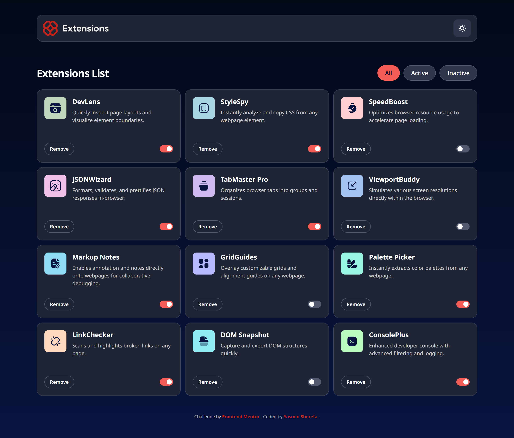
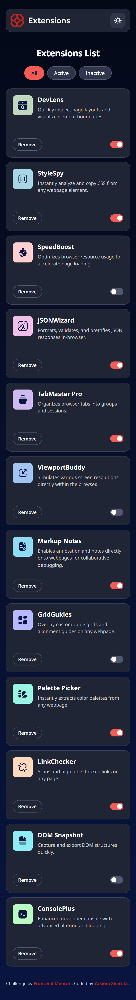

# Browser Extension Manager

A responsive and interactive browser extension manager built with HTML, CSS, and JavaScript.

This project was developed as part of a [Frontend Mentor](https://www.frontendmentor.io/) challenge to practice frontend development skills, including dynamic data rendering, DOM manipulation, filtering, responsive layouts, and theme switching.

## Overview

The Browser Extension Manager allows users to manage a collection of browser extensions through a clean and user-friendly interface.


## Screenshots

<details>
<summary>View Desktop Screenshot</summary>



</details>

<details>
<summary>View Mobile Screenshot</summary>



</details>


### Features

- **View Extensions:** Dynamically displays extension information from a local JSON file.
- **Filter Extensions:** Filter the list to show all, active, or inactive extensions.
- **Toggle Extensions:** Activate or deactivate individual extensions.
- **Remove Extensions:** Remove extensions with a confirmation dialog.
- **Theme Switching:** Switch between light and dark themes.
- **Persistent Data:** Uses localStorage to remember extension states and theme preferences.
- **Responsive Design:** Optimized layouts for desktop, tablet, and mobile devices.
- **Interactive States:** Includes hover and keyboard focus states for interactive elements.

## Technologies Used

- HTML5
- CSS3
- JavaScript (Vanilla JS)
- JSON
- Local Storage API

## Project Structure

```text
browser-extensions-manager/
│
├── assets/
│   ├── images/
│   └── fonts/
│
├── screenshots/
│   ├── desktop-dark.png
│   └── mobile-dark.png
│
├── index.html
├── style.css
├── script.js
├── data.json
└── README.md
```

## Getting Started

### 1. Clone the repository

```bash
git clone YOUR_REPOSITORY_URL
```

### 2. Navigate to the project folder

```bash
cd browser-extensions-manager
```

### 3. Run the project

Open the project in Visual Studio Code and launch `index.html` using the Live Server extension.

**Note:** Running the project through a local development server is recommended because the application loads extension data using the Fetch API.

## What I Learned

Through this project, I practiced:

- Working with JSON data and the Fetch API.
- Dynamically creating and updating HTML elements using JavaScript.
- Implementing filtering and interactive UI controls.
- Managing application state with JavaScript.
- Using localStorage to preserve user preferences.
- Building responsive layouts with CSS Grid and Flexbox.
- Improving accessibility with semantic HTML and ARIA attributes.

## Author

**Yasmin Sherefa**

Frontend Mentor Challenge

